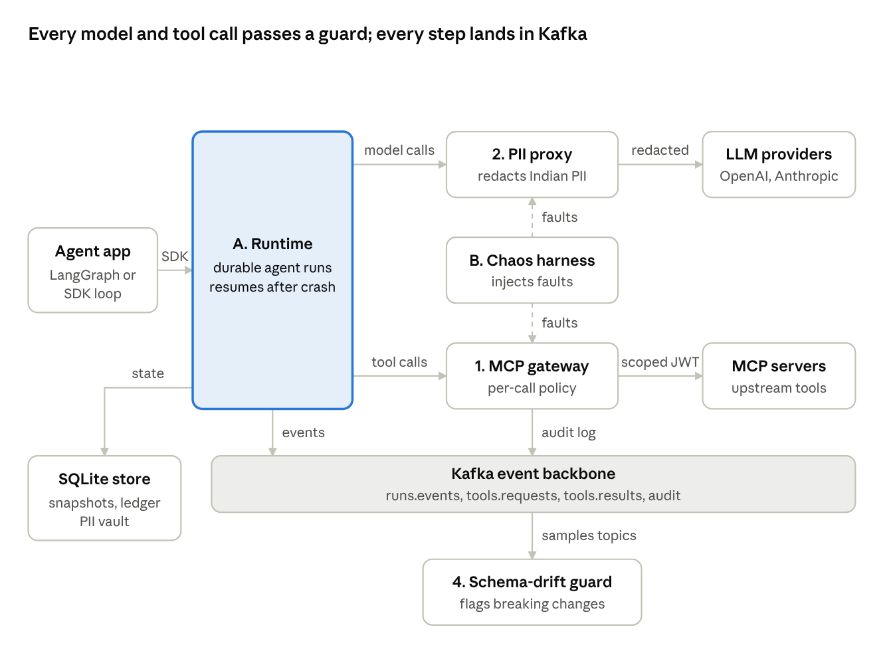

# Keel (working name)

Open-source infrastructure that makes AI agents durable, secure, private and testable in production. It has five components that work on their own but share one Kafka event backbone.

**Status (2026-11-05): documentation only.** No code is written until each component meets the Definition of Ready (ADR-009). The live, editable version of these docs is the Claude doc: https://claude.ai/artifact/ADds9g77atPpDQsyFcQ2EW. This folder is a snapshot of it.

## Components

| # | Component | What it does | Language |
| --- | --- | --- | --- |
| A | Durable runtime | Agent runs survive crashes; an effects ledger stops repeated side effects. Built on Restate or DBOS (ADR-001) | Follows the engine |
| 1 | Zero-trust MCP gateway | Per-call policy, per-call scoped tokens, tool pinning, taint-driven approvals, hash-chained audit | Go |
| B | Chaos harness | Injects faults at the gateway and LLM proxy and scores how agents recover | Python |
| 2 | DPDP PII proxy | Swaps Indian personal data for reversible tokens before prompts reach an LLM | Python |
| 4 | Schema-drift guard | Learns Kafka topic schemas from traffic and names the consumer code a change will break | Go + Python |



## Documents

| File | Contents |
| --- | --- |
| [docs/design-overview.md](docs/design-overview.md) | Problem, goals, architecture, per-component design, build plan, risks |
| [docs/requirements.md](docs/requirements.md) | Canonical requirements with IDs, priority and acceptance criteria |
| [docs/test-plan.md](docs/test-plan.md) | Test strategy, proof tests, traceability, test data rules |
| [docs/adr/](docs/adr/) | Architecture decision records (log in `docs/adr/README.md`) |
| [docs/ways-of-working.md](docs/ways-of-working.md) | Cadence, Definition of Ready/Done, practices, boundaries |
| [docs/prior-art.md](docs/prior-art.md) | Existing tools compared, and where Keel differs |
| [CHANGELOG.md](CHANGELOG.md) | Dated log of what changed |

## Planned repo layout (ADR-007)

```
keel/
  contracts/      JSON Schemas for events, audit records, tokens
  runtime/        component A
  gateway/        component 1 (Go)
  harness/        component B (Python)
  pii-proxy/      component 2 (Python)
  drift-guard/    component 4 (Go + Python)
  deploy/         docker-compose, terraform
  tooling/        shared lint config
  results/        proof-test outputs by date
  docs/           ADRs and design (this folder)
```

Component folders are created only when that component reaches Definition of Ready.

## Next steps

1. Review the docs; settle the remaining open questions (name, injection benchmark).
2. Run the one-week engine evaluation for ADR-001 (Restate vs DBOS).
3. Redraw the build-plan timeline with the shorter runtime phase.
4. Get component A to Definition of Ready, then start code.
