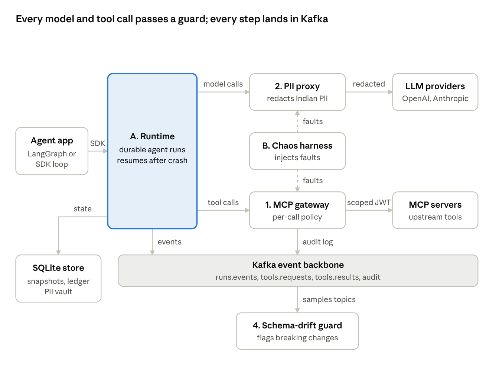
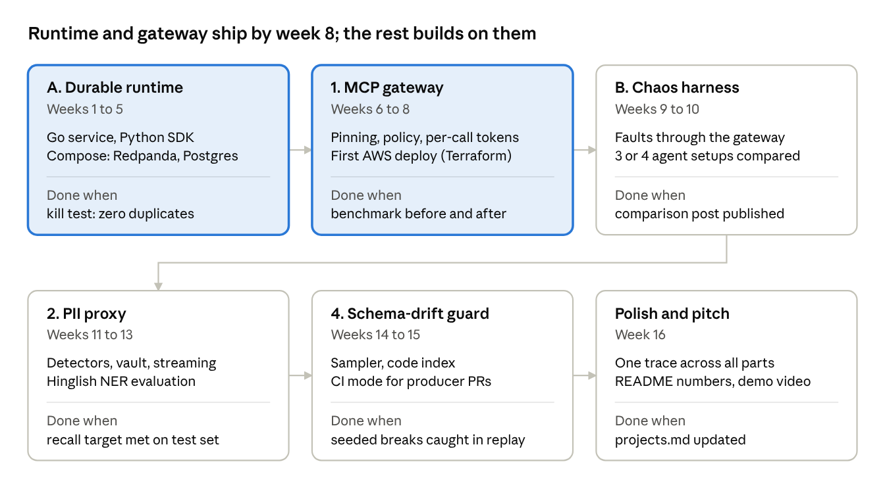

# Design overview

Snapshot of the Claude doc's main tab, 2026-11-05. Canonical requirements live in [requirements.md](requirements.md); decisions in [adr/](adr/).

**Current phase: documentation only. No code until each component meets the Definition of Ready.**

## Overview

Keel (working name) is an open-source infrastructure layer that makes AI agents durable, secure, private and testable in production. It is five components that work alone but share one event backbone, so together they read as one platform.

**Problem.** Teams can get an agent demo working in a day, then spend months on the parts the demo skipped: the agent loses work when a process dies, a retried step sends the same email twice, a poisoned tool description leaks data, customer PII goes straight to a third-party model, and nobody knows how the agent behaves when a tool times out.

**Who it is for.** Platform and backend teams at mid-size product companies running agents against internal tools, especially Indian companies with DPDP Act obligations.

**Why this author.** Each component extends work already done in production: Kafka event pipelines, circuit-breaker load balancing, zero-trust tokenization with key rotation, and context-feeding services for internal agents. No telecom or eSIM functionality is in scope.

**Status.** Requirements and initial design. Nothing built yet.

## Goals, non-goals and success metrics

The platform succeeds if every component ships with a public repo, a one-command local demo, and one measured number a prospective user can verify for themselves.

**Goals**

1. Agents resume after a crash from their last completed step, with no duplicated side effects.
2. Every tool call an agent makes is authorized per call, least privilege, and auditable.
3. Indian PII never leaves the company boundary in plain form when calling an external LLM.
4. Breaking schema changes on Kafka topics are caught before consumers break.
5. Agent resilience is measurable and comparable across agent frameworks.
6. Each component runs standalone; all five run together from one Docker Compose file and one AWS deployment.

**Non-goals**

- Building an agent framework or a model. Keel wraps LangGraph, plain SDK loops, or any MCP client.
- A hosted SaaS, billing, or multi-region HA in v1.
- A UI beyond a minimal audit and results viewer.
- Anything telecom, eSIM or entitlement related.

**Success metrics (targets to validate, not results)**

| Component | Metric | v1 target |
| --- | --- | --- |
| Durable runtime | Tasks completed correctly with 30% of workers killed at random | 100%, zero duplicate side effects |
| MCP gateway | Attack block rate on a public injection benchmark (e.g. AgentDojo) | Measure baseline, then improve; report both |
| MCP gateway | Added latency per tool call | p99 under 10 ms |
| PII proxy | Detection recall / precision on a labelled Indian PII set | Recall above 95%, precision above 90% |
| Schema-drift guard | Breaking changes caught in replayed incidents | All seeded breaking changes, alert under 60 s |
| Chaos harness | Frameworks scored | 3 or 4, results published |

## System architecture

The runtime sits in the middle: model calls go out through the PII proxy, tool calls through the MCP gateway, and every step and audit record lands on Kafka, where the drift guard watches the topics.

The chaos harness has no path of its own; it injects faults at the two guards (dashed), so any agent can be tested without code changes.

**Shared stack**

| Layer | Choice | Why |
| --- | --- | --- |
| Runtime, gateway, drift sampler | Go (runtime follows the ADR-001 engine) | Low latency; fills the Go gap |
| PII proxy, chaos harness, SDK, drift explainer | Python (FastAPI) | NLP and agent-framework ecosystems |
| Event backbone | Kafka (Redpanda for local dev) | Ordered per-run log, transactions, consumer groups |
| State | SQLite first; Postgres or Redis only on a measured need (ADR-006) | Snapshots, effects ledger, manifests, PII vault |
| Observability | OpenTelemetry traces, Prometheus metrics | One trace per run across all components |
| Deploy | Docker Compose locally; AWS (ECS Fargate or EKS) with Terraform | Fills the AWS gap |
| CI | GitHub Actions running the proof tests and chaos suite | Numbers regenerate on every merge |

## Component A: durable agent runtime

Every agent step is written to Kafka as an event before it counts as done, so any worker can rebuild a run from its log and continue. Client SDK in Python.

**Update (ADR-001, accepted).** Step persistence and recovery will come from Restate or DBOS, chosen in a one-week evaluation. Keel's original work here is the effects ledger, Kafka handoff and the SDK wrapper. The design below stays as the reference for what the engine must provide.

### Requirements (summary; see requirements.md)

- FR-A1. Start, get, cancel and list runs through an HTTP/gRPC API.
- FR-A2. Persist every step (model call, tool call, decision) as an ordered event per run.
- FR-A3. On worker death, another worker resumes the run from its last completed step without re-calling the model for steps already done.
- FR-A4. Each tool call carries an idempotency key; a retried call never repeats a completed side effect.
- FR-A5. Human-in-the-loop: a run can pause on an approval and resume on a signal.
- FR-A6. Multi-agent: agents hand work to each other through topics, not direct calls.
- FR-A7. Python SDK wraps a LangGraph graph or a plain SDK loop with a decorator, no rewrite.
- Non-functional targets: resume within 5 s of worker death; under 20 ms p99 added per step; strict order per run.

### Design

**Topics.** `runs.commands` (start, cancel, signal), `runs.events` (keyed by `run_id`, so one run stays on one partition, in order), `tools.requests`, `tools.results`, `runs.dlq`.

**Event types.** RunStarted, StepScheduled, ModelCallCompleted, ToolCallRequested, ToolCallCompleted, AwaitingSignal, StepCompleted, RunCompleted, RunFailed.

**Ownership and recovery.** Workers form one consumer group. Whoever owns a partition owns its runs. On rebalance, the new owner loads the latest snapshot from the state store and replays later events to rebuild state. Recorded model responses are replayed, not re-requested, so recovery is deterministic and costs no tokens.

**Exactly-once state changes.** Event-to-event transitions use Kafka transactions (read, process, write and commit offset atomically). Writes to the state store use a transactional outbox, relayed to Kafka.

**Side effects.** Key = hash(run_id, step, tool, args). The tool executor writes an `intent` row to an effects ledger (unique on key) before calling, and `done` after. On retry: `done` returns the stored result; `intent` without `done` passes the key as an Idempotency-Key header where the tool supports it, otherwise the step is marked `unknown` and paused for compensation or approval. Exactly-once against an arbitrary external API is not possible; the design makes the uncertain case visible instead of guessing.

**Snapshots.** Every 50 events or 30 s, whichever first (tunable).

**Proof test.** A chaos script kills 30% of workers at random during 1,000 runs that each send a mock email and write a mock payment. Pass = every run completes and the mock services see zero duplicates.

## Component 1: zero-trust MCP gateway

The gateway is an MCP proxy that checks every tool call against policy at runtime, mints a short-lived token scoped to that one call, and fails closed. Written in Go.

### Requirements (summary; see requirements.md)

- FR-G1. Proxy MCP over stdio and Streamable HTTP.
- FR-G2. Pin and sign tool definitions; a changed definition is blocked until re-approved.
- FR-G3. Policy per call on agent identity, end user, tool, arguments and data labels.
- FR-G4. Mint a per-call JWT (audience = tool, TTL under 60 s, argument constraints as claims).
- FR-G5. Taint tracking: untrusted tool output marks the session; tainted sessions need approval for high-risk tools.
- FR-G6. Scan tool output for injection patterns, as a policy signal only.
- FR-G7. Hash-chained, append-only audit log, also published to Kafka.
- FR-G8. Approval requests go to the runtime as signals.
- Non-functional targets: under 10 ms p99 added; fail closed; keys rotate every 24 h via JWKS.

### Design

**Request path.** Client authenticates (mTLS or OIDC) → manifest check against pinned hash → policy evaluation → token mint → forward upstream → scan response and update taint → audit record → return.

**Policy engine.** CEL (ADR-004). Policies live in a Git repo and hot-reload.

**Tokens.** Asymmetric-signed JWT with tool, argument hash and unique ID claims (ADR-005).

**Manifests.** Stored in the state store with signature and approver. Diffs between versions shown on re-approval.

**Evaluation.** Run a public prompt-injection benchmark (AgentDojo is the candidate) with and without the gateway. Report attack success rate and task utility both ways, so the cost of blocking is visible.

## Component 2: DPDP PII redaction proxy

The proxy swaps Indian personal data for reversible tokens before a prompt leaves the company, and swaps them back in the response. Written in Python (FastAPI). It supports DPDP obligations; it does not by itself make anyone compliant, and the docs must say so.

### Requirements (summary; see requirements.md, IDs FR-X*)

- Drop-in proxy for OpenAI and Anthropic message APIs, including streaming; optional Kafka mode.
- Detect Aadhaar (Verhoeff), PAN, GSTIN, UPI ID, IFSC, Indian mobile numbers, voter ID, passport, vehicle registration.
- Detect names and addresses in English, Devanagari Hindi and romanised Hinglish.
- Stable typed reversible tokens (`<PAN_7f3a>`); restore values in the response.
- Purpose and consent check; audit; erasure of a data principal's vault entries.
- Targets: under 50 ms p99 for a 2,000-token prompt; recall above 95%, precision above 90%.

### Design

**Pipeline.** Normalise text (Unicode, digit forms) → rule detectors (regex + checksum) → NER model for names and addresses → merge overlapping spans → tokenise → forward.

**NER.** Evaluate an existing Indic NER model (AI4Bharat's work is the first candidate) against a small fine-tune if Hinglish recall is weak.

**Vault.** Its own SQLite file (ADR-006); values encrypted with AES-256-GCM under per-tenant data keys, wrapped by a master key (envelope encryption). Token = HMAC of the value under the tenant key, so the same value maps to the same token within a tenant.

**Streaming restore.** Buffer only across chunk boundaries where a partial token could be split, then flush.

**Test set.** Synthetic Indian PII dataset (generated, never real data), published with the repo, plus checksum-valid fake identifiers.

## Component 4: Kafka schema-drift guard

The guard learns each topic's real schema from live traffic, flags breaking changes within a minute, and names the consumer code that will break. Sampler in Go; code index and LLM explainer in Python.

### Requirements (summary; see requirements.md)

- Sample JSON topics with a read-only consumer group; use Schema Registry where present.
- Infer schemas over a rolling window; classify changes as breaking or additive.
- Index consumer repos, map services to fields, alert with services, code locations and an explanation.
- CI mode for producer PRs; Keel's own topics are the first test subjects.
- Targets: alert within 60 s; sampling under 1% of throughput.

### Design

**Inference.** Per field path, keep counters of seen types and presence over the window; a field is "required" above 99.9% presence. Reservoir sampling bounds memory.

**Code index.** Parse consumer repos with tree-sitter (TypeScript, Python, Go, Java), find deserialisation points tied to a topic name, and record field accesses.

**Explainer.** The model gets the diff, the matched code snippets and the inferred schemas, and writes the alert text. The match itself is deterministic; the model only explains.

**Proof test.** Replay a recorded topic, inject 20 seeded breaking changes and 20 additive ones, and measure caught, missed and false alarms.

## Component B: chaos harness for agents

The harness breaks tools and models on purpose during agent runs and scores how well the agent recovers. It injects faults at the MCP gateway and the LLM proxy, so agents need no code changes. Written in Python.

### Requirements (summary; see requirements.md)

- Faults: tool timeout, HTTP 429 and 500, malformed JSON, truncated output, schema-breaking output, latency spikes, injected instructions, context-flooding output, model provider outage.
- Seeded YAML scenarios; adapters for 3 or 4 agent setups (LangGraph, OpenAI Agents SDK, plain loop, Keel runtime).
- Record success, recovery, duplicates, unsafe actions, extra tokens and cost; generate a markdown report.
- Targets: 50 tasks in under 30 min with a mock model; reruns within 2 points with a real model.

### Design

**Injection points.** The gateway exposes a fault hook per tool call; the PII proxy (or a thin LLM proxy) exposes one per model call. The harness drives both through a control API.

**Tasks.** Multi-step tasks against mock services that count side effects, so duplicates and unsafe actions are measured, not guessed.

**Score.** Report each metric separately; a single resilience score is a weighted sum with weights stated in the report.

**Write-up.** Publish the comparison as a post. It doubles as marketing and a lead-generation asset.

## Build plan and milestones

The runtime and the gateway are the core and ship first; every later phase is optional and adds one more standalone capability customers can adopt on its own.

**Phase 0 (now): documentation.** Requirements, test plan, decisions and ways of working are written and reviewed before any code (ADR-009). Then the one-week engine evaluation for ADR-001. With ADR-001, component A should take about 3 weeks instead of 5; the timeline below still shows 5 and will be redrawn once the engine is picked.

**What each component delivers to users**

Each component stands alone as an adoptable product and carries one headline metric
a user can reproduce from the public repo.

| Component | Value to the user | Primary adopter | Headline metric (filled once measured) |
| --- | --- | --- | --- |
| A. Durable runtime | Agents survive crashes and never repeat a side effect (no double charges or emails) | Platform/backend teams running agents against money or messaging | N runs completed with 30% of workers killed and zero duplicate side effects |
| 1. MCP gateway | Every tool call is authorized per call with a short-lived scoped token; tamper-proof audit | Security and platform teams exposing internal tools to agents | Injection success cut from X% to Y% at Z ms p99 overhead |
| B. Chaos harness | A repeatable resilience score for any agent, with no code changes | Teams hardening agents before production | N agent setups scored across M fault types, results published |
| 2. PII proxy | Indian PII never leaves the company boundary in plain form; supports DPDP obligations | Indian product companies with DPDP obligations calling external LLMs | X% recall at Y ms p99 on a 2,000-token prompt |
| 4. Schema-drift guard | Breaking Kafka schema changes caught before consumers break, with the exact code named | Data-platform teams running Kafka with many consumers | X of 20 seeded breaks caught, alert in under Y s |

## Risks and open questions

| Risk | Impact | Mitigation |
| --- | --- | --- |
| Scope: five components is a lot to build and maintain | Nothing ships | Ship A and 1 first as the core product; each later component is optional and stands alone |
| Strong incumbents in agent security or durable execution | Harder differentiation | Validate the residual gap each component fills before building it; lean on the integrated combination and reproducible numbers |
| AWS cost for demos | Running cost | Single self-run broker for demos; tear down after recording; budget alarm at US$20 |
| Low early adoption | Product stalls | One-command local demo and a standalone value per component lower the trial barrier; publish reproducible benchmarks |
| Benchmark numbers look weak | Weak market claim | Report baseline and improvement honestly; a credible measured number beats an inflated one |

**Open questions**

- [ ] Final name (Keel is a placeholder; check GitHub and PyPI).
- [ ] Which public injection benchmark: confirm AgentDojo's licence and setup cost.
- [x] Policy language: CEL (ADR-004).
- [x] Kafka or Redpanda locally: Redpanda (ADR-002).
- [x] Build the runtime or use an engine: Restate or DBOS (ADR-001).
- [x] Monorepo or per-component repos: monorepo, split-ready (ADR-007).
- [ ] Licence: decided at publish time (ADR-008).
