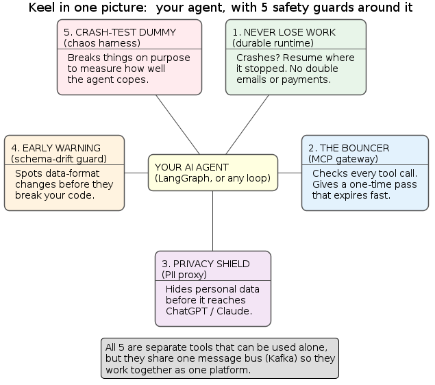
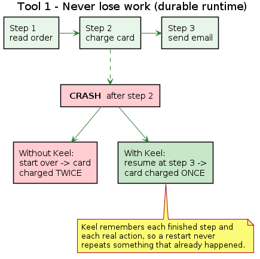
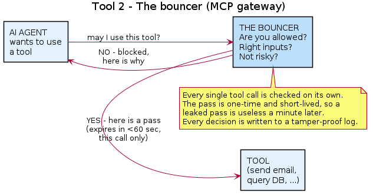
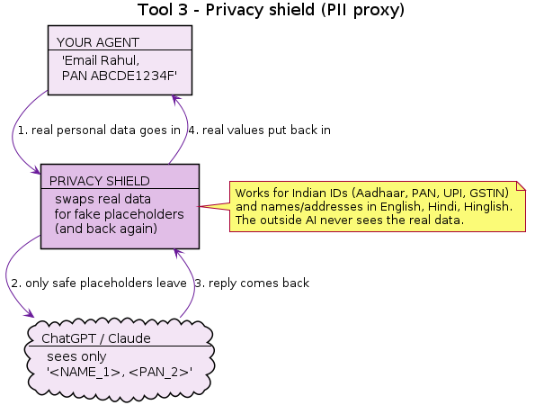
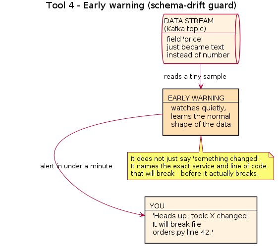
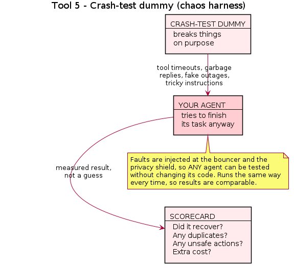

# Keel, explained simply

A plain-language guide to what Keel is, what it does, and how it helps.
No jargon. If you have never touched the code, this is the page to read first.

<!-- START doctoc generated TOC please keep comment here to allow auto update -->
<!-- DON'T EDIT THIS SECTION, INSTEAD RE-RUN doctoc TO UPDATE -->
<!-- END doctoc generated TOC please keep comment here to allow auto update -->

## The one-line version

Keel is a set of **five safety tools that wrap around an AI agent** so it can be
trusted to run real tasks without losing work, leaking data, or doing damage.

## First, what is an "AI agent"?

An AI agent is a program that uses an AI model (like ChatGPT) to **decide what to
do, and then actually do it** — step by step. For example:

> "A customer emailed asking for a refund."
> The agent reads the email, looks up the order, refunds the card, and sends a
> confirmation — on its own.

That is powerful, but also scary. The agent is making real decisions and taking
real actions: spending money, sending messages, reading private data. When it
goes wrong, it goes wrong with real consequences.

**Keel is the safety equipment for that agent.** Like seatbelts, airbags, and
brakes in a car: none of them make the car move, but they stop it from hurting
anyone when something goes wrong.

## The big picture

Picture your agent in the middle, with five guards standing around it. Every one
of them protects against a specific way agents fail in real life.

Each guard is a **separate tool** — you can use just one, or all five. They share
one common "message bus" (think of it as a shared noticeboard) so that when used
together, they behave like a single platform.

## The five tools, one by one

### Tool 1 — Never lose work

**The problem:** An agent task has many steps. If the program crashes halfway, a
naive system starts over from the beginning. That can mean charging a card twice
or sending the same email twice.

**What Keel does:** It remembers every finished step and every real action. After
a crash, it continues from the last good step — and never repeats something that
already happened.

**How it helps:** No lost progress, no embarrassing double-charges, no wasted AI
costs re-doing work. This is the heart of the whole project.

### Tool 2 — The bouncer

**The problem:** Agents use "tools" (send email, query a database, call an API). A
tricked or over-powered agent could use a tool to do something harmful or leak
data.

**What Keel does:** Like a club bouncer, it checks **every single tool request** —
"Are you allowed? Are the inputs okay? Is this risky right now?" If yes, it hands
out a one-time pass that expires in under a minute. If anything is off, it says no.

**How it helps:** Even a misbehaving agent can only do what it is explicitly
allowed to do, right now, for that one action. Everything is logged in a way that
cannot be secretly edited.

### Tool 3 — Privacy shield

**The problem:** To use ChatGPT or Claude, you send them your text. If that text
contains a customer's personal data, it just left your company and went to an
outside company. For Indian businesses, that is also a legal concern (the DPDP
Act).

**What Keel does:** Before the text leaves, it finds personal data and swaps it
for fake placeholders. The outside AI only ever sees the placeholders. When the
answer comes back, Keel puts the real values back in.

**How it helps:** You still get to use powerful external AI models, but your
customers' real data never leaves your walls. It is built for **Indian** IDs
(Aadhaar, PAN, UPI, GSTIN) and for names/addresses in English, Hindi, and Hinglish.

> Honest note: this *supports* privacy-law compliance. It does not, by itself,
> make a company fully compliant.

### Tool 4 — Early warning

**The problem:** Agents and services pass data to each other in a certain shape
(e.g. "price is a number"). If someone changes that shape ("price is now text"),
code that reads it breaks — often silently, discovered only after it fails.

**What Keel does:** It quietly watches the data flowing by, learns what "normal"
looks like, and the moment something changes in a breaking way, it warns you — and
points to the **exact file and line** that will break.

**How it helps:** You fix the problem before it causes an outage, instead of
debugging a mystery failure afterwards.

### Tool 5 — Crash-test dummy

**The problem:** You do not really know how your agent behaves when a tool times
out, returns garbage, or an AI model goes down — until it happens in production.

**What Keel does:** It deliberately breaks things during a test run — timeouts,
garbage replies, fake outages, even sneaky instructions — and then scores how well
the agent coped. This is the one piece that is genuinely a "harness".

**How it helps:** You get a real, repeatable score for how resilient your agent is,
so you can improve it with evidence instead of hope.

## What Keel is NOT

- **Not an AI model.** It does not think or write answers. It guards the agent that does.
- **Not an agent framework.** You keep using your existing setup (LangGraph, a plain
  loop, anything). Keel wraps around it.
- **Not a product you buy.** It is open-source infrastructure you run yourself.
- **Not finished.** Right now it is only design documents and diagrams — no code has
  been written yet, on purpose, until the design is solid.

## "Is there something like this already?"

No single product does all five jobs. Each tool has its own look-alikes:

| Keel tool | Similar existing products | What makes Keel different |
| --- | --- | --- |
| 1. Never lose work | Temporal, Restate, DBOS, Inngest | Those recover from crashes but leave the "don't charge twice" problem to you. Keel adds exactly that missing safety layer (and even plans to build on Restate or DBOS). |
| 2. The bouncer | API gateways, new MCP security tools | Keel decides **per single call**, considering the inputs and how sensitive the data is — not just "is this user allowed". |
| 3. Privacy shield | Microsoft Presidio, Nightfall, Skyflow | Keel specializes in **Indian** personal data and Hindi/Hinglish text, for DPDP needs. |
| 4. Early warning | Confluent Schema Registry, Great Expectations | Those enforce or check rules. Keel learns the shape from live traffic **and** names the exact code that will break. |
| 5. Crash-test dummy | Chaos Monkey (for servers) | Chaos Monkey breaks servers. Keel breaks **tools and AI models mid-agent-task** and scores recovery. |

**The real difference** is not any one tool — it is that all five fit together over
one shared backbone. No existing product offers that combination.

## In short

> AI agents are powerful but unpredictable, and the actions they take are real.
> Keel is the safety layer that makes an agent **survive crashes, ask permission,
> protect private data, warn you early, and prove it can handle failure** — so you
> can actually trust it in production.

## Want more detail?

- Full technical design: [../design-overview.md](../design-overview.md)
- Exact requirements: [../requirements.md](../requirements.md)
- Technical UML diagrams: [../uml/](../uml/)
