# Keel UML diagrams

UML models derived from the design docs ([design-overview.md](design-overview.md),
[requirements.md](requirements.md), [adr/](adr/)) as of the 2026-11-05 snapshot.

All diagrams are PlantUML. Render with the PlantUML CLI, the server, or any IDE
plugin. These model the *intended* design — the repo is documentation-only, so no
code is reflected, only the specified behaviour and contracts.

<!-- START doctoc generated TOC please keep comment here to allow auto update -->
<!-- DON'T EDIT THIS SECTION, INSTEAD RE-RUN doctoc TO UPDATE -->
<!-- END doctoc generated TOC please keep comment here to allow auto update -->

## 1. Platform component diagram

How the five components wire together around the Kafka backbone. The runtime is
central: model calls exit via the PII proxy, tool calls via the MCP gateway, every
step and audit record lands on Kafka, and the drift guard watches the topics. The
chaos harness has no data path of its own — it drives fault hooks on the two guards.

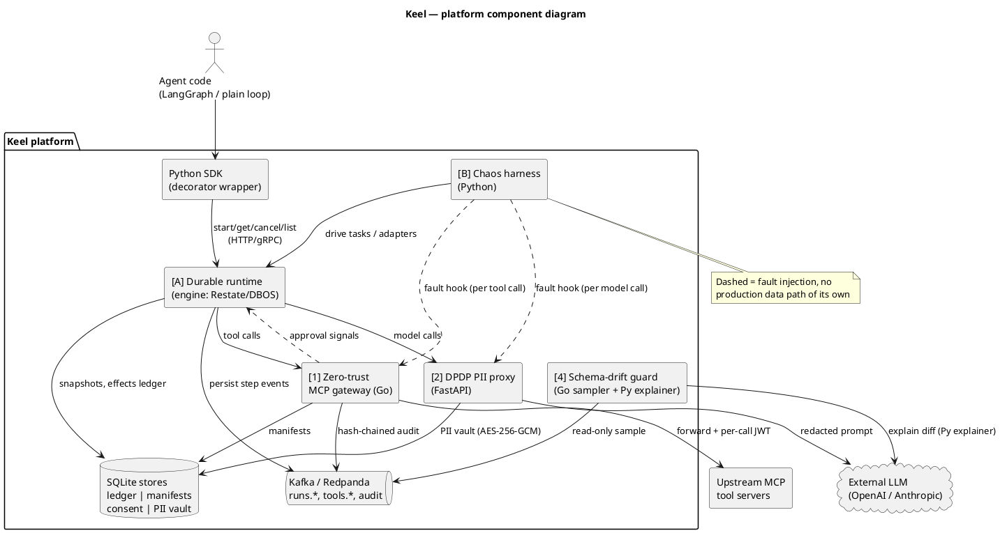

## 2. Deployment diagram

Local (`docker compose up`, 16 GB laptop) and the AWS demo environment
(Terraform, ECS Fargate or EKS). Observability via OpenTelemetry + Prometheus.

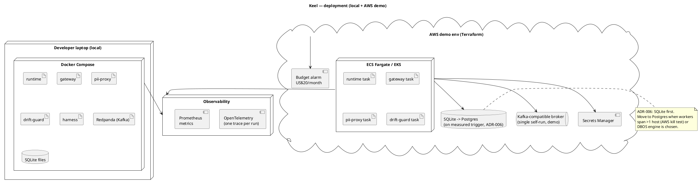

## 3. Class / domain model — [A] Durable runtime

Event-sourced per run. Steps persist as ordered events keyed by `run_id`; the
effects ledger guards side effects by `hash(run_id, step, tool, args)`.

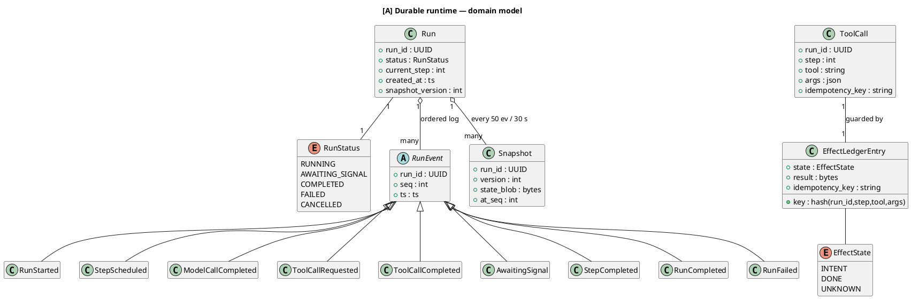

## 4. Class / domain model — [1] MCP gateway

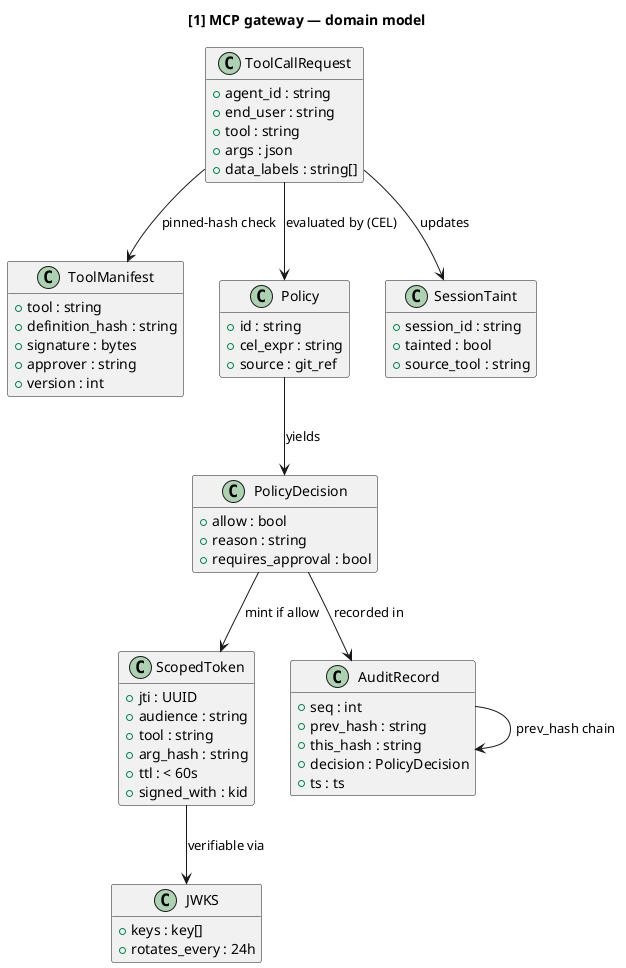

## 5. Class / domain model — [2] PII proxy

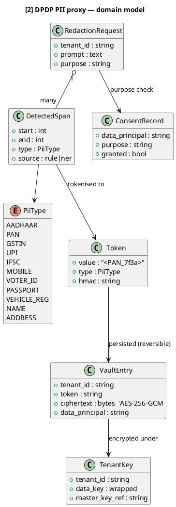

## 6. Class / domain model — [4] Schema-drift guard

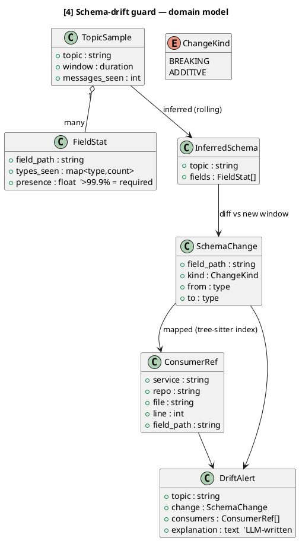

## 7. Class / domain model — [B] Chaos harness

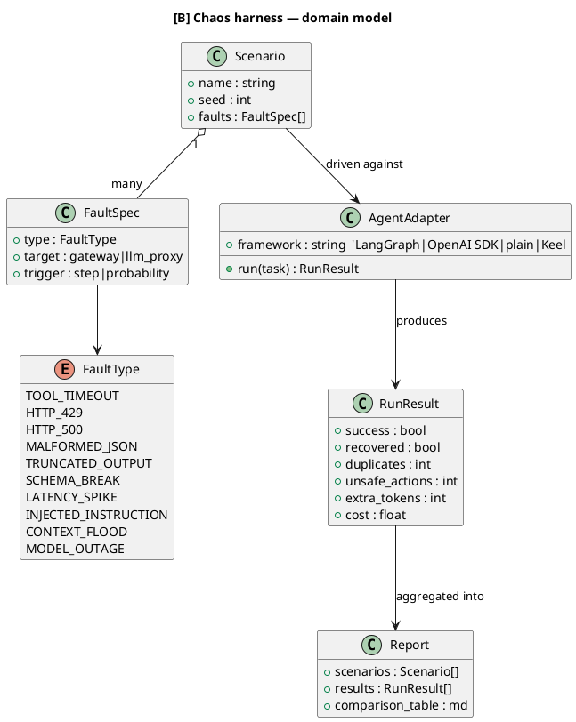

## 8. Sequence — durable run with crash recovery (FR-A2/A3/A4)

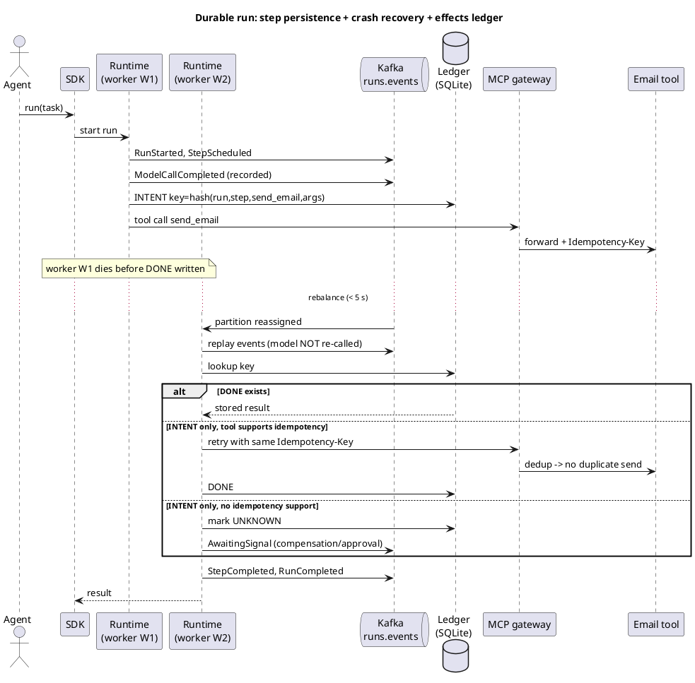

## 9. Sequence — zero-trust tool call (FR-G2..G8)

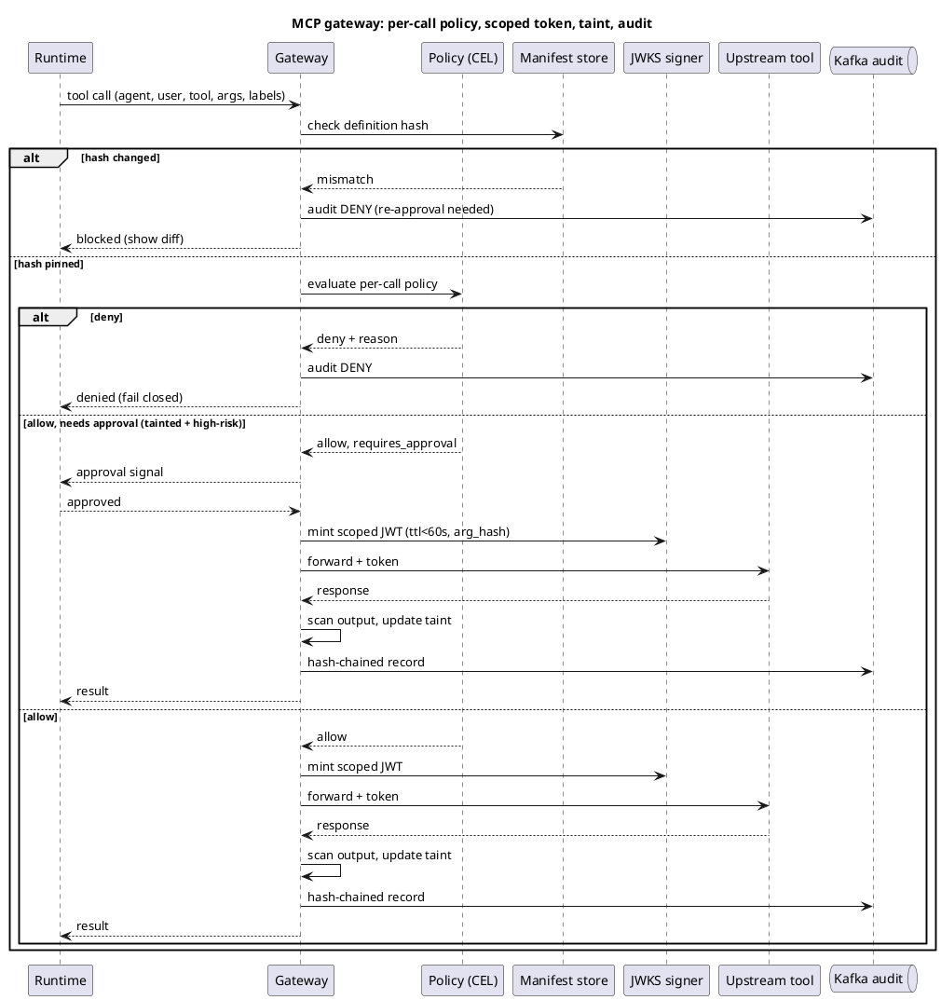

## 10. Sequence — PII redaction round trip (FR-X1/X3/X5)

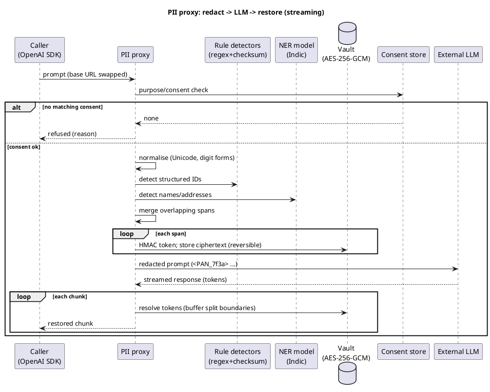

## 11. Sequence — schema-drift detection (FR-D2..D5)

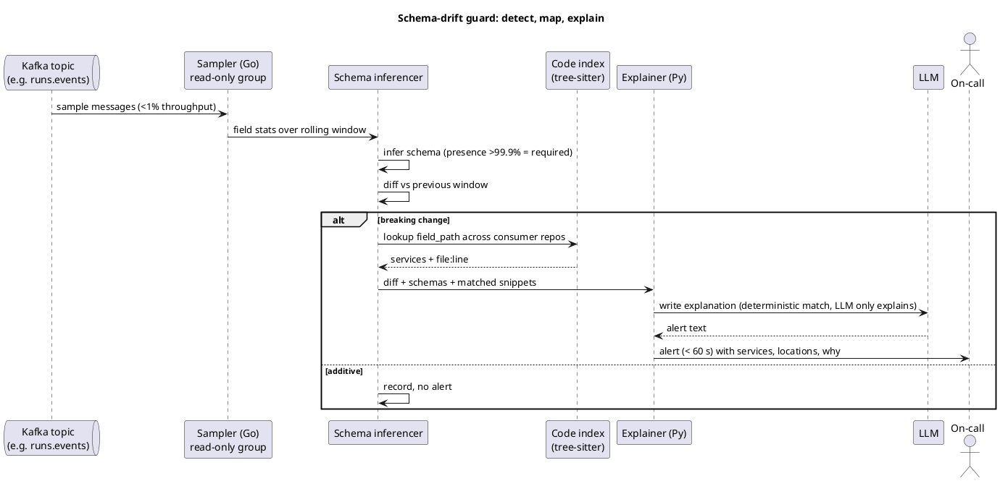

## 12. Sequence — chaos injection run (FR-C1..C5)

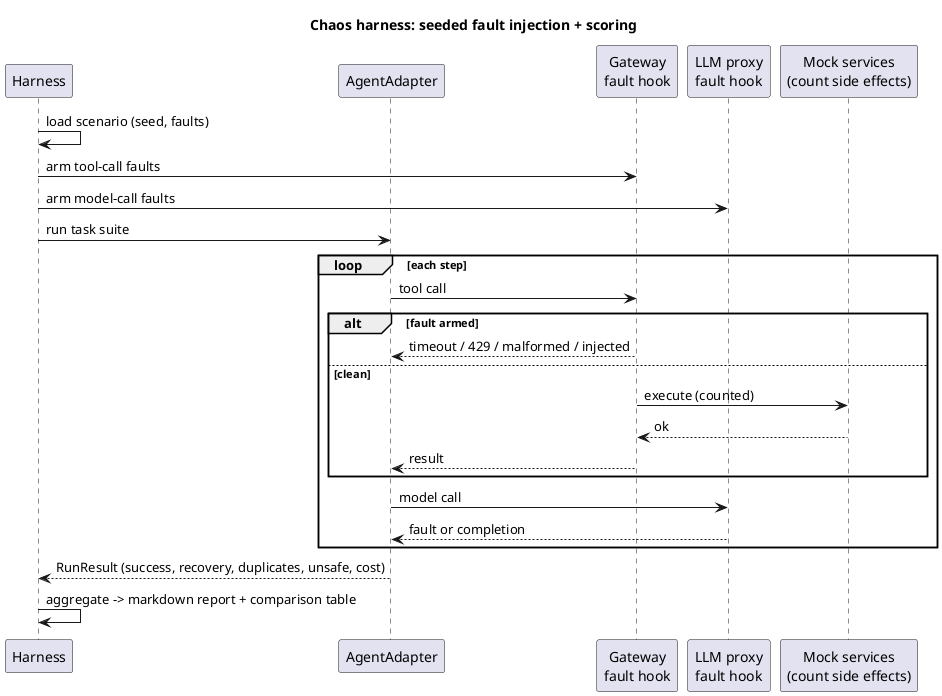

## 13. State machine — run lifecycle (FR-A1/A3/A5)

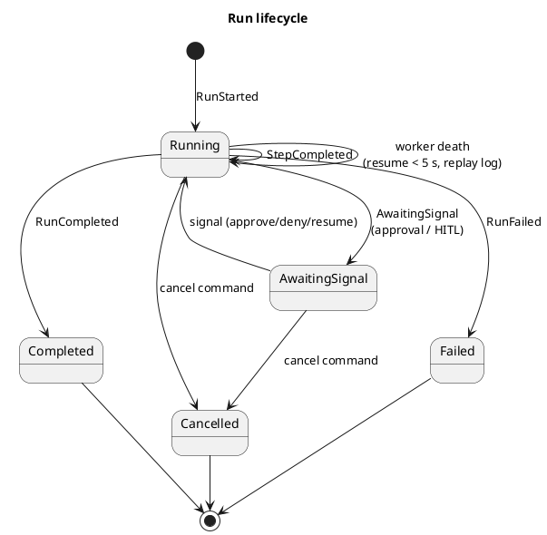

## 14. State machine — effects ledger entry (FR-A4)

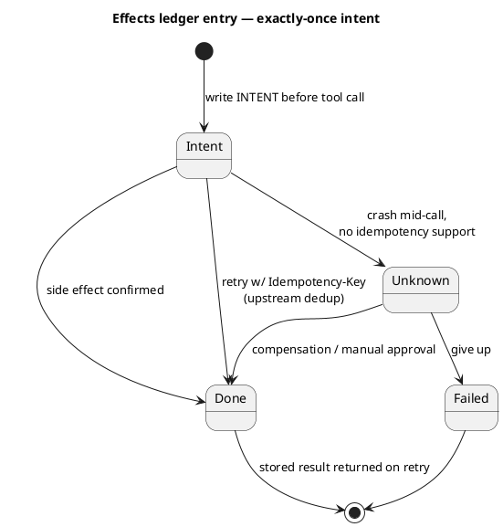

## 15. State machine — session taint (FR-G5)

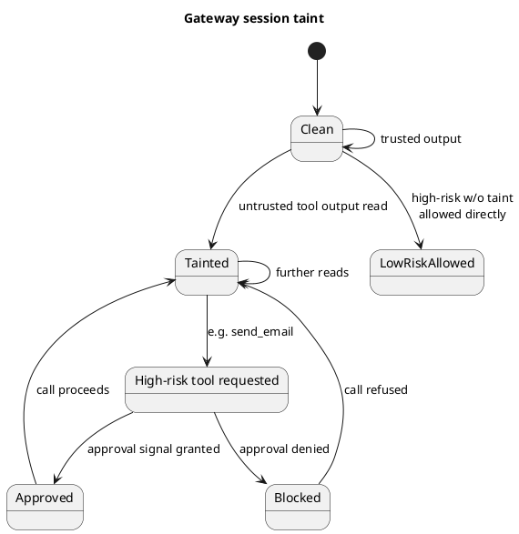

## Traceability

| Diagram | Primary requirements |
| --- | --- |
| 1 Platform components | FR-P1, FR-P2 |
| 2 Deployment | FR-P1, FR-P3, NFR-P3, NFR-P6, ADR-006 |
| 3 Runtime class model | FR-A2, FR-A4 |
| 4 Gateway class model | FR-G2..G7, ADR-004, ADR-005 |
| 5 PII class model | FR-X3, FR-X5, NFR-X3, ADR-006 |
| 6 Drift class model | FR-D2..D5 |
| 7 Chaos class model | FR-C1..C5 |
| 8 Durable-run sequence | FR-A2, FR-A3, FR-A4, NFR-A1 |
| 9 Gateway-call sequence | FR-G2, FR-G3, FR-G4, FR-G5, FR-G7, FR-G8, NFR-G2 |
| 10 PII sequence | FR-X1, FR-X3, FR-X5, FR-X6 |
| 11 Drift sequence | FR-D2, FR-D3, FR-D4, FR-D5, NFR-D1 |
| 12 Chaos sequence | FR-C1, FR-C2, FR-C4, FR-C5 |
| 13 Run lifecycle | FR-A1, FR-A3, FR-A5 |
| 14 Effects ledger | FR-A4 |
| 15 Session taint | FR-G5 |
